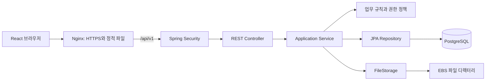

# 아키텍처와 기술 선택

## 단일 애플리케이션, 기능별 모듈

하나의 Spring Boot 프로세스와 하나의 PostgreSQL DB로 시작한다. 평가룸·발표·평가·초대는 서로 연결되어 있어 하나의 DB 트랜잭션으로 처리하는 편이 단순하다. 기능별 패키지로 책임을 분리해 규모가 커져도 코드 위치를 쉽게 찾도록 한다.

이 그림은 향후 배포 구성이다. 현재 단계에서는 로컬 Spring Boot와 PostgreSQL로 구현한다. 로컬 Vite는 `/api`를 Spring Boot로 프록시한다. 운영에서는 React와 API를 같은 출처로 제공해 쿠키 인증과 라우팅을 단순하게 만든다.

## MVC를 적용하는 방법

- View: 기존 React 화면. Spring에서 HTML 템플릿을 생성하지 않는다.
- Controller: URL, HTTP 입력 검증, 인증 사용자 추출, 응답 상태를 담당한다.
- Model: JPA 엔티티와 업무 규칙을 포함한다. 엔티티를 HTTP 응답으로 직접 내보내지 않는다.
- Service: 권한 확인, 업무 처리 순서, 트랜잭션 경계를 담당한다.
- Repository: 엔티티 저장과 조회를 담당한다. 여러 테이블을 읽는 결과 화면은 전용 조회 Repository/DTO projection을 사용한다.

컨트롤러는 Repository를 직접 호출하지 않는다. Service 인터페이스와 Impl을 항상 쌍으로 만들지 않고, 초기에는 구체 Service 클래스를 사용한다. 저장소 교체 가능성이 있는 FileStorage에는 인터페이스를 둔다.

## 기술 선택

| 구성 | 제안 | 이유 |
|---|---|---|
| 언어/런타임 | Java 21 | LTS 기반으로 개발·운영 환경 통일 |
| 웹 | Spring Boot, Spring MVC | REST API와 계층 구조 구현 |
| 인증/인가 | Spring Security, 서버 세션 | 단일 웹 서비스에서 로그아웃과 권한 회수를 단순하게 처리 |
| 세션 저장 | Spring Session JDBC | 같은 PostgreSQL에 저장해 재시작 시 세션 상태 보존 |
| DB | PostgreSQL | 관계/제약조건/트랜잭션, 조건부 고유 인덱스 활용 |
| DB 접근 | Spring Data JPA | 기본 CRUD와 엔티티 관리; 복잡한 집계는 JPQL/SQL |
| 스키마 | Flyway | 변경 SQL을 버전 관리하고 환경별로 재현 |
| 검증 | Jakarta Bean Validation | 요청 DTO 검증 |
| 테스트 | JUnit, Spring Boot Test, Testcontainers PostgreSQL | 실제 DB의 잠금과 제약조건 검증 |
| 빌드 | Gradle Wrapper | 개발 PC와 빌드 환경 일치 |

MySQL도 이 서비스의 요구사항을 충족한다. PostgreSQL 선택은 동접 50명의 필수 조건이나 일률적인 성능 우위 때문이 아니다. 대기 초대의 조건부 중복 방지 등 데이터 무결성 규칙을 직접 표현하는 데 활용한다. DB를 변경하면 Flyway SQL, 조건부 인덱스, 잠금/집계 쿼리를 재검토해야 한다.

## 요청 처리 예: 평가 제출

1. Security가 세션과 CSRF 토큰을 검증한다.
2. Controller가 점수/피드백 DTO를 검증하고 로그인 사용자의 ID를 전달한다.
3. RatingService가 트랜잭션을 시작하고 평가룸 행을 잠근다.
4. 참여 자격, OPEN 상태, 발표와 대상의 소속, 평가 제한과 수정 허용을 검사한다.
5. 기존 평가를 갱신하거나 새 평가를 저장한다.
6. 커밋 후 응답한다. 오류가 나면 DB 변경 전체를 롤백한다.

처음에는 평가룸 단위 쓰기를 직렬화해 마감·설정 변경·평가 제출 간 경쟁을 제어한다. 50명 동시 제출 시험으로 대기 시간을 측정하고, 병목이 확인된 경우에만 잠금 범위를 세분화한다.

## 운영 경계

PostgreSQL과 업로드 디렉터리는 영속 저장소에 둔다. 파일은 Spring 애플리케이션의 빌드 디렉터리 밖에 저장한다. JVM heap 초기 예산은 1 GiB 수준에서 측정하되 DB, OS, 네이티브 메모리까지 합산한다. DB 연결 풀은 10개 수준에서 시작해 부하 시험으로 조정한다. 이 수치는 초기 가정이다.

업무시간 제한은 EC2 스케줄과 별개다. 서비스가 반드시 09~18시에만 평가를 받아야 한다면 서버의 별도 정책으로 구현한다. 현재 백엔드 1차 범위에는 이 제한을 강제하지 않는다.

## 공식 참고 자료

- [Spring Boot 코드 구조](https://docs.spring.io/spring-boot/reference/using/structuring-your-code.html)
- [Spring Data JPA 트랜잭션](https://docs.spring.io/spring-data/jpa/reference/jpa/transactions.html)
- [Spring Security CSRF와 SPA](https://docs.spring.io/spring-security/reference/servlet/exploits/csrf.html)
