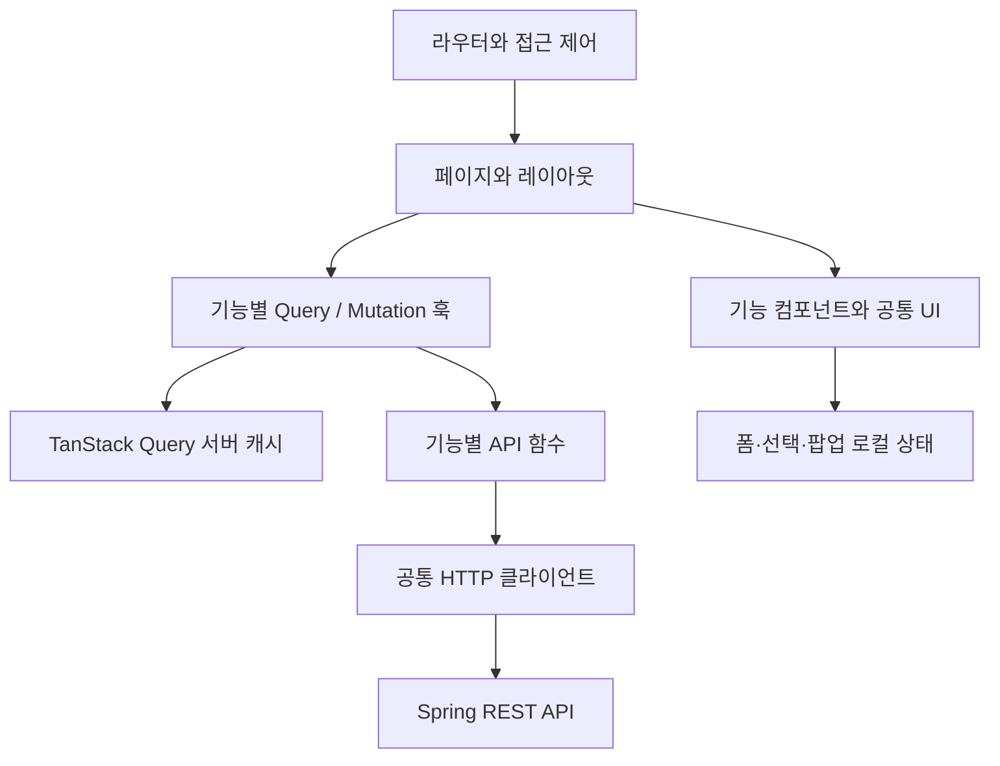

# 아키텍처와 상태 관리

## 기능별 React SPA

기존 React/Vite 앱에서 서버 API를 연결하는 방향을 권장한다. 서버 렌더링이나 별도 프런트 서버가 필요한 요구사항은 현재 없다. React 정적 빌드는 향후 Nginx에서 제공하고 `/api/v1`은 Spring으로 전달한다.

데이터는 페이지 → 기능 컴포넌트 → 공통 UI 순으로 내려보낸다. 공통 버튼/필드는 특정 API나 전역 데이터 저장소를 직접 참조하지 않는다. 기능 훅은 서버 요청과 캐시 갱신을 캡슐화한다. 페이지는 라우트 파라미터와 조회 상태를 조립한다.

## 상태 소유권

| 상태 | 소유 위치 | 예시 |
|---|---|---|
| 서버 원본 | Query 캐시 | me, 평가룸, 발표, 내 점수, 결과, 초대 |
| 폼 초안 | useState/useReducer | 점수 문자열, 피드백, 발표 편집, 설정 |
| 탐색 상태 | URL search params | 검색어, 정렬, 페이지, 관리자 tab |
| 단기 UI | 가까운 공통 부모의 state | 열린 팝업, 선택 팀 ID, 메뉴 |
| 표시용 파생값 | 렌더링 중 계산/필요 시 useMemo | 상태 라벨, 평균 표시, 첨부 용량 |
| 인증 비밀 | 서버 세션 쿠키 | JS에서 읽거나 sessionStorage에 저장하지 않음 |

기본적으로 Redux/Zustand를 추가하지 않는다. Query 캐시와 React 로컬 상태로 해결되지 않는 공유 상태가 실제로 생기면 검토한다. 같은 서버 데이터를 별도 전역 store에 다시 복사하지 않는다. 선택 대상은 전체 객체 대신 ID로 저장해 재조회 이후 오래된 객체를 계속 표시하지 않도록 한다.

## 현재 구조에서 이동할 부분

현재 store.ts의 DB 전체 스냅샷은 전환 기간 동안 `/state` 어댑터로 유지한다. 이후 화면별 조회 훅으로 교체한다. 서버 캐시와 기존 store가 같은 화면의 원본을 동시에 소유하지 않도록 화면 단위로 전환한다.

logic.ts의 날짜/용량/라벨/정렬 표현은 프런트에 남긴다. 평가 허용 여부는 서버가 반환하는 capability/제한 사유를 기준으로 표시하고 클라이언트 계산은 보조 안내로만 사용한다. 평균과 평가자별 집계는 서버 결과 DTO를 사용한다. 서버가 권한상 보내지 않은 점수를 로컬에서 추정하지 않는다.

## 편집과 자동 갱신

서버 재조회는 입력 중인 점수/피드백을 자동 초기화하지 않는다. 서버의 저장본과 draft를 분리하고 dirty 상태를 관리한다. 평가 대상/평가룸이 바뀌거나 사용자가 취소할 때만 초안을 초기화한다. 저장 성공 시 서버 응답 또는 확인 조회로 저장본을 확정한다.

편집 중 룸 마감·권한 회수·설정 변경이 확인되면 저장을 막고 원인을 표시한다. 입력값을 무조건 지우지 않는다. 네트워크 오류로 커밋 여부가 불명확하면 내 평가를 재조회해 확인한 뒤 재제출을 안내한다. 저장 요청의 자동 재시도는 기본적으로 끈다.

## 참고

- [React 상태 구조](https://react.dev/learn/choosing-the-state-structure)
- [React 상태 공유](https://react.dev/learn/sharing-state-between-components)
- [TanStack Query 변경 이후 무효화](https://tanstack.com/query/latest/docs/framework/react/guides/invalidations-from-mutations)
